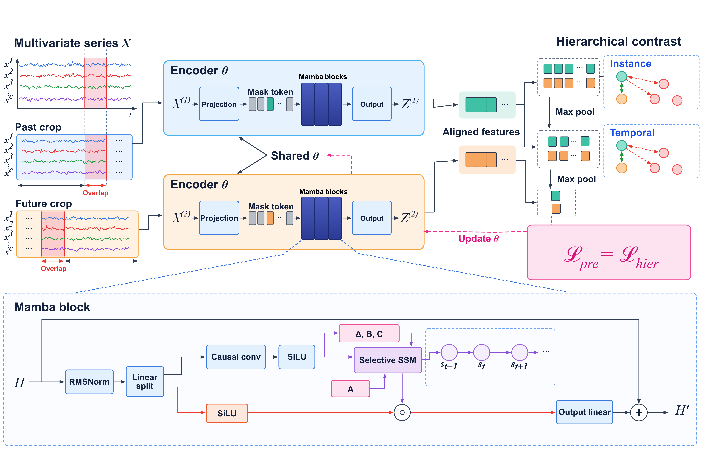
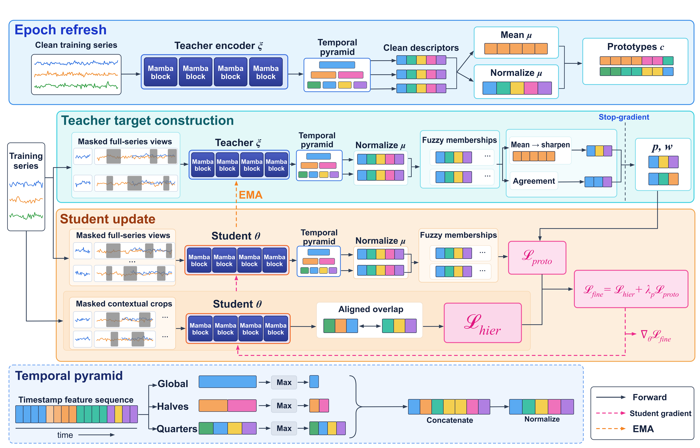

# MFTC: Mamba-based Fuzzy Teacher-guided Clustering for multivariate time series

[](https://www.python.org/)
[](https://pytorch.org/)
[](https://developer.nvidia.com/cuda-toolkit)
[](https://github.com/state-spaces/mamba)
[](environment.yml)
[](https://timeseriesclassification.com)

Official implementation of **MFTC**, a framework for inductive clustering of multivariate time
series. MFTC learns a clustering space without labels and assigns unseen series using only
quantities fitted on the training collection.

The method works in two stages:
1. **Self-supervised pretraining.** A stack of unidirectional Mamba blocks encodes every timestamp.
   Projected timestamps are randomly replaced by a learnable mask token. Two overlapping
   contextual crops are aligned on their shared timestamps and trained with a hierarchical
   instance and temporal contrastive loss.



2. **Fuzzy prototype-based fine-tuning.** A temporal pyramid (max over 1, 2 and 4 regions of equal
   duration) turns the timestamp features into one normalized vector per series that retains
   coarse event placement. An EMA teacher produces sharpened fuzzy cluster targets, weighted by
   the agreement between two masked views. The student is trained to reproduce them while the
   contrastive loss stays active.


At inference, a test series is encoded without masking and assigned to the closest fuzzy
prototype. The training mean and the prototypes are never refitted on the test data.

## 📁 Repository structure

```
MFTC/
├── train.py            # training + evaluation of all datasets and seeds
├── analysis.py         # tables, latent-space scores and plots from the trained runs
├── environment.yml     # conda environment
├── model/
│   ├── encoder.py      # mask token, Mamba blocks, temporal pyramid readout
│   ├── losses.py       # contextual crops and hierarchical contrastive loss
│   └── mftc.py         # teacher/student model, fuzzy memberships, teacher targets, L_proto
└── utils/
    ├── data.py         # UEA ARFF loading, preprocessing, adaptive batch size, seeding
    ├── metrics.py      # ARI, NMI, RI, FMI, F1, ACC
    └── analysis.py     # silhouette and kNN accuracy, t-SNE projections, loss curves
```

## ⚙️ Installation

Requirements: Linux, an NVIDIA GPU, and conda (Miniconda or Anaconda).
The code was developed with Python 3.10, PyTorch 2.5.1 (CUDA 12.1) and `mamba-ssm` 2.2.4.

```bash
# 1. Create and activate the environment (PyTorch and the other dependencies)
conda env create -f environment.yml
conda activate mftc

# 2. Install mamba-ssm (it needs PyTorch already installed, hence the separate step)
pip install mamba-ssm==2.2.4 --no-build-isolation

# 3. Check the installation
python -c "import torch, mamba_ssm; print(torch.__version__, torch.cuda.is_available())"
```

Step 2 downloads a prebuilt `mamba-ssm` wheel when one matches the system. Otherwise it compiles
the CUDA kernels with the toolkit included in the environment, which takes several minutes. To
compile only for your GPU, set its compute capability first, for example:

```bash
export TORCH_CUDA_ARCH_LIST="7.5"   # 7.5 Turing (RTX 20xx, Quadro RTX), 8.0 A100, 8.6 RTX 30xx, 8.9 RTX 40xx, 9.0 H100
MAMBA_FORCE_BUILD=TRUE pip install mamba-ssm==2.2.4 --no-build-isolation
```

## 📊 Data

MFTC uses the multivariate datasets of the
[UEA archive](https://timeseriesclassification.com) in ARFF format, with one file per dimension.
Each dataset folder must contain the files `<Dataset>Dimension<d>_TRAIN.arff` and
`<Dataset>Dimension<d>_TEST.arff`:

```
<data-root>/
├── BasicMotions/
│   ├── BasicMotionsDimension1_TRAIN.arff
│   ├── BasicMotionsDimension1_TEST.arff
│   ├── ...
│   └── BasicMotionsDimension6_TEST.arff
├── UWaveGestureLibrary/
└── ...
```

This is the layout of the `Multivariate2018_arff` archive and of the single-dataset zip files
available on the archive website. The original train/test splits are used. Missing values and
shorter series are zero-filled, and every series and channel is standardized independently.
Labels are used only to set the number of clusters K and to compute the evaluation metrics.

## 🚀 Usage

The full pipeline has two commands: `train.py` trains and evaluates the models, and `analysis.py`
builds the tables and figures from the saved outputs, without running the models again.

```bash
python train.py    --data-root /path/to/Multivariate_arff --output-dir results   # 15 datasets x seeds 1, 2, 3
python analysis.py --results results                                             # tables and plots
```

Quick test (one dataset, one seed, a few epochs):

```bash
python train.py --data-root /path/to/Multivariate_arff --datasets BasicMotions --seeds 1 \
                --pretrain-epochs 5 --finetune-epochs 5
```

Main options (`python train.py --help` lists all of them):

| Option | Default | Meaning |
|---|---|---|
| `--data-root` | required | folder containing one subfolder per dataset |
| `--datasets` | the 15 datasets of the paper | datasets to run |
| `--seeds` | `1 2 3` | random seeds |
| `--output-dir` | `results` | where results are written |
| `--device` | `cuda:0` | GPU to use |
| `--pretrain-epochs` / `--finetune-epochs` | `100` / `100` | epochs of the two stages |
| `--overwrite` | off | rerun runs that already have results |

Completed runs are skipped, so an interrupted experiment can be restarted with the same command.

`analysis.py` options: `--results` (output folder of `train.py`), `--no-plots` (tables only),
`--knn` (neighbours of the kNN accuracy, default 5), `--dpi` (resolution of the figures, default 300).


## 🗂️ Data and Resources
The data used in this study are available in the [UEA Time Series Classification Archive](https://timeseriesclassification.com/index.php).

## 📝 Citation

The paper is currently under review. If you use this code, please cite:

```bibtex
@article{cerciello2026mftc,
  title   = {MFTC: Mamba-based Fuzzy Teacher-guided Clustering for multivariate time series},
  author  = {Cerciello, Donato and Schiavo, Leonardo and Panizo-Lledot, Angel and Huertas Tato, Javier and Camacho, David},
  year    = {2026},
  note    = {Under review}
}
```

## 💎 Acknowledgment

This work was supported by the MSCA Doctoral Networks project T.U.A.I. - Towards an Understanding of Artificial Intelligence via a transparent, open and explainable perspective (TUAI) project, N°101168344.

